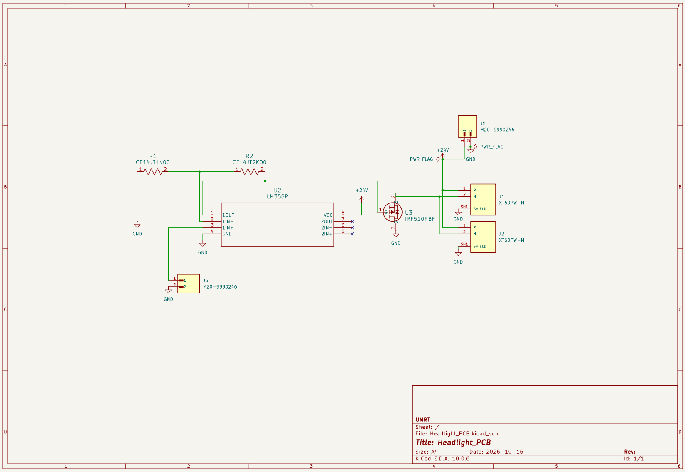

# UMRT Rover Headlight Controller PCB

Custom high-power 24V LED headlight driver module designed for the University of Manitoba Robotics Team (UMRT) rover platform. This circuit provides robust switching control using a low-voltage control signal to drive high-draw 24V auxiliary lighting through heavy-duty XT60 power connections.

---

## 🛠️ System Architecture & Specifications

* **Input Power:** +24V DC bus (XT60PW-M connectors)
* **Switching Element:** IRF510 / IRF540N N-Channel Power MOSFET
* **Control Circuitry:** LM358 Low-Power Dual Operational Amplifier configured as a buffer/driver stage
* **Signal Inputs:** M20-9990246 header pins for microcontroller/Jetson logic signals
* **Passive Components:** 1kΩ and 2kΩ axial metal/carbon film resistors (1/4W THT)
* **EDA Tool:** KiCad 

---

## Schematic



## 📂 Repository Structure

```text
umrt-rover-headlights/
├── hardware/
│   ├── schematic/       # KiCad schematic files (.kicad_sch)
│   ├── pcb/             # PCB layout and board files (.kicad_pcb)
│   └── footprints/      # Custom UMRT & component libraries (.pretty)
├── documentation/       # Datasheets, pinouts, and design notes
└── README.md
